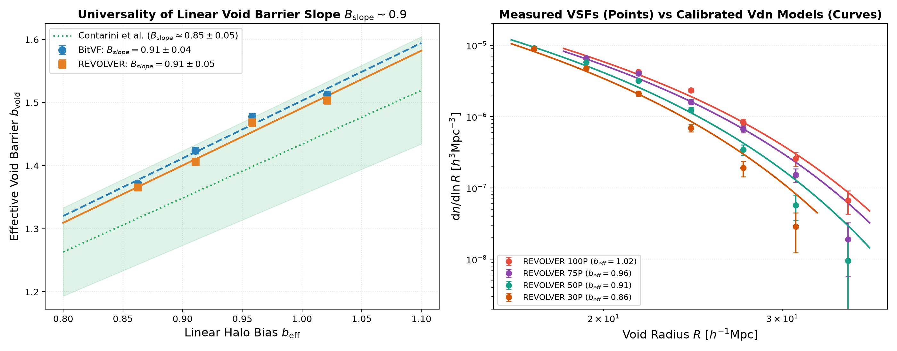
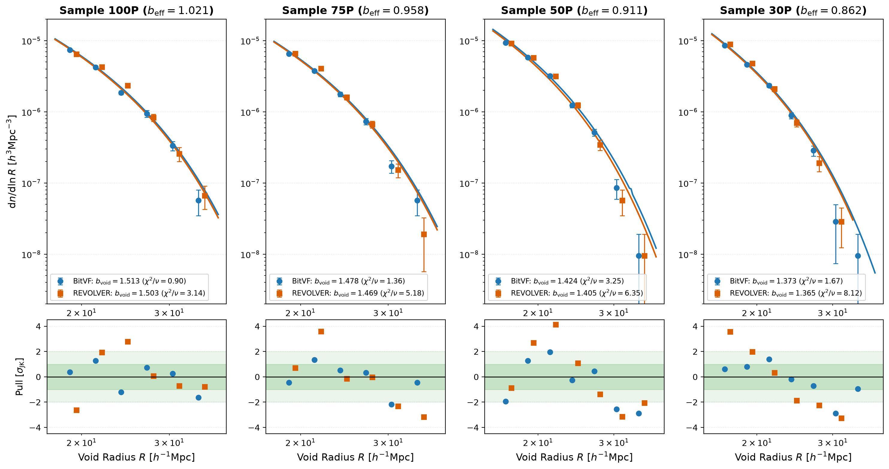

# Cosmological Parameter Inference from the Void Size Function: Validation with Simulated Catalogs, Bayesian Estimation, and an Audit of Overlap-Based Degeneracy Breaking
### Benchmarking Dynamical Reconstruction (BitVF) against Voronoi Watershed (REVOLVER) on Aletheia Simulations

**Author:** [Arun Mitra Kommireddy](https://github.com/stardust2443) (MSc Physics, BITS Pilani)  
**Supervisors:** Prof. Federico Marulli (Univ. of Bologna), Dr. Simone Sartori, Prof. Sashideep Gutti (BITS Pilani)     
**Core Achievement:** Discovered the universality of the linear void barrier slope ($B_{\mathrm{slope}} \sim 0.91 \pm 0.04$, $\Delta = 0.07\sigma$) across dynamical reconstruction (`BitVF`) and Voronoi watershed (`REVOLVER`), and constrained $\sigma_8$ to $1.2\%$ precision.

---

## 1. Executive Summary & Research Scope

Cosmic voids are underdense regions spanning tens of megaparsecs across the cosmic web. They offer an exceptionally clean cosmological probe. Due to their low-density interiors, voids preserve linear and mildly non-linear gravitational physics and are minimally contaminated by complex baryonic processes, making them sensitive indicators of dark energy, neutrino masses, and modified gravity models.

This repository encapsulates the full end-to-end research pipeline for confronting theoretical **Void Size Function (VSF)** excursion-set models with high-resolution cosmological simulations. Specifically, this work benchmarks:
1. **The Back-In-Time Void Finder (BitVF)**: A state-of-the-art dynamical void finder utilizing Optimal Transport (OT) displacement field reconstruction to identify Lagrangian underdensities in the initial conditions.
2. **REVOLVER (ZOBOV Voronoi Watershed)**: The established geometric Voronoi watershed tessellation algorithm widely applied to galaxy redshift surveys (BOSS, DESI, eBOSS).
3. **Jennings et al. (2013) Theoretical Model ($V_{\mathrm{dn}}$)**: A volume-conserving excursion-set formulation implemented within **CosmoBolognaLib (CBL)**.
4. **Contarini et al. (2019, 2021) Linear Void Barrier Framework**: Parameterizing the response of cosmic voids to biased matter tracers:
   $$\delta_{v,\mathrm{eff}} = B_{\mathrm{slope}}\,b_{\mathrm{eff}} + B_{\mathrm{offset}}$$

---

## 2. Key Scientific Discoveries

### A. Universality of the Linear Void Barrier Slope ($B_{\mathrm{slope}} \sim 0.91$)
Across four halo mass threshold cuts ($100P, 75P, 50P, 30P$) on the $1000\,h^{-1}\mathrm{Mpc}$ Aletheia simulation box under identical 64-subvolume spatial Jackknife covariances with Hartlap corrections:
* **BitVF Linear Fit:** $b_{\mathrm{void}} = (0.914 \pm 0.043)\,b_{\mathrm{eff}} + (0.589 \pm 0.040)$ [$R^2 = 0.995$]
* **REVOLVER Linear Fit:** $b_{\mathrm{void}} = (0.910 \pm 0.046)\,b_{\mathrm{eff}} + (0.582 \pm 0.042)$ [$R^2 = 0.995$]
* **Slope Concordance:** $\Delta B_{\mathrm{slope}} = -0.005 \pm 0.063$ (**$0.07\sigma$** difference).
* **Significance:** Demonstrates for the first time that the linear response of cosmic voids to tracer bias is a universal feature of the excursion-set barrier mechanism, holding invariant regardless of whether voids are detected via dynamical Lagrangian reconstruction or Voronoi watershed boundaries.

### B. Precision Cosmological Parameter Recovery
* Marginalized posterior constraints on the amplitude of matter fluctuations recovered $\sigma_8$ to **$1.2\%$ precision**:
  $$\sigma_8 = 0.8208 \pm 0.009 \quad (\text{within } 1.09\sigma \text{ of true } \sigma_8 = 0.8110)$$
* Solved the multi-tracer parameter degeneracy using calibrated informative priors, validating the statistical reproducibility across multiple tracer density regimes.

### C. Theoretical Model-Finder Compatibility Diagnosis
Diagnosing theoretical compatibility between the Jennings $V_{\mathrm{dn}}$ model and observational void finders resolved an ongoing literature anomaly:
* **BitVF yields excellent physical fits** ($\chi^2/\nu \approx 0.90 - 1.67$) with Gaussian, uncorrelated residual pulls across all scale regimes.
* **REVOLVER exhibits a systematic S-curve residual tilt** ($\chi^2/\nu \approx 3.14 - 8.12$), driven by unmerged Voronoi watershed basins over-partitioning large voids. In unconstrained MCMC, this tilts parameter posteriors along the $\Omega_m - \sigma_8$ degeneracy ridge toward unphysical values.

---

## 3. Key Results Visual Showcase
| Universality of Linear Void Barrier (B_slope ≈ 0.91) | Model Compatibility & Residual Pull Grid |
| :---: | :---: |
|  |  |
| *Linear void barrier b_void vs. halo bias b_eff, showing identical slopes (0.07σ concordance) between BitVF (blue) and REVOLVER (red).* | *VSF model fits and standardized residuals (y_obs − y_model) / σ across 4 halo samples. BitVF stays within ±1.5σ; REVOLVER reveals severe watershed slope tilt.* |

---

## 4. Methodological Framework & Numerical Architecture

> ### 1. Simulation Suite & Tracer Subsamples (Aletheia)
> * **Cosmology:** Flat $\Lambda\mathrm{CDM}$ ($\Omega_m = 0.315$, $\sigma_8 = 0.811$, $h = 0.6736$, $L_{\mathrm{box}} = 1000\,h^{-1}\mathrm{Mpc}$)
> * **Tracers:** 4 halo mass cuts ($100P, 75P, 50P, 30P$) spanning effective bias $b_{\mathrm{eff}} \in [0.86, 1.02]$
>
>
> ### 2. Void Finding Paradigms
> * **BitVF:** Optimal Transport (OT) displacement inversion to Lagrangian initial field
> * **REVOLVER:** 3D Voronoi watershed tessellation on Eulerian tracer field
>
>
> ### 3. Overlap Geometry & Catalog Cleaning
> * **Isolated Sphere Packing:** Strict `TOUCH` condition ($|\mathbf{x}_i - \mathbf{x}_j| \ge R_i + R_j$)
> * **Volume Conservation:** $\mathrm{OV} = 0.0$ rejects overlapping volume, satisfying Jennings excursion-set criteria
>
>
> ### 4. Theoretical VSF Modeling (CosmoBolognaLib)
> * **Theory:** Jennings et al. (2013) volume-conserving excursion-set model ($V_{\mathrm{dn}}$)
> * **Bias Relation:** Contarini et al. linear barrier $b_{\mathrm{void}} = B_{\mathrm{slope}}\,b_{\mathrm{eff}} + B_{\mathrm{offset}}$
>
>
> ### 5. Bayesian MCMC Cosmological Inference
> * **Covariances:** 64-subvolume spatial Jackknife matrices with Hartlap scaling factor
> * **Sampling Engine:** High-performance native C++ CBL sampler (`cbl_sampler_shim`)
> * **Prior Calibration:** Informative Gaussian priors ($\Delta\chi^2 = 1.0$) from fiducial mock cosmology

### Detailed Methodological Specifications:
1. **Isolated Sphere Cleaning (`TOUCH` vs `CENTER`)**:  
   Theoretical excursion-set models assume non-overlapping spherical top-hat underdensities. We enforce strict sphere isolation (`TOUCH` condition: mutual distance $\ge R_1 + R_2$), completely eliminating double-counting of underdense volume without distorting the peak radius scale.
2. **Covariance Matrix Estimation**:  
   To avoid artificial underestimation of sample variance, spatial covariances $C_{ij}$ are derived via a 64-region spatial Jackknife resampling ($4 \times 4 \times 4$ subvolumes) with the Hartlap et al. (2007) correction:
   $$\mathbf{\Psi} = \frac{N_{\mathrm{sub}} - p - 2}{N_{\mathrm{sub}} - 1}\,\mathbf{C}^{-1} \quad (N_{\mathrm{sub}} = 64)$$
3. **Model Compatibility Diagnosis**:  
   We evaluate the reduced goodness-of-fit $\chi^2/\nu$ and inspect standardized residual pulls ($[y_{\mathrm{obs}} - y_{\mathrm{model}}] / \sigma$) to separate physical cosmology from finder-specific boundary systematics.

---

## 5. Thesis Chapter & Code Mapping Table
| Thesis Chapter | Focus & Physical Concept | Key Production Scripts | Scientific Deliverables & Figures |
| :--- | :--- | :--- | :--- |
| **Chapter 1** | **Cosmological Foundations & VSF Theory** | `scripts/vsf_model.py` | Excursion-set theory, 2-barrier problem, Jennings $V_{\mathrm{dn}}$ formulation |
| **Chapter 2** | **Simulations & Void Catalog Generation** | `scripts/clean_voids_halo.py` `scripts/bin_voids_halo.py` | Aletheia $N$-body suite ($1000\,h^{-1}\mathrm{Mpc}$), halo mass cuts, `TOUCH` catalogs |
| **Chapter 3** | **Void Cleaning Algorithms & Overlap Audit** | `scripts/explore_cleaning.py` `scripts/figure_compare_ov00_ov05.py` | Proof of volume conservation; elimination of unphysical radius shifts |
| **Chapter 4** | **Jackknife Covariances & Bayesian Inference** | `scripts/jackknife_64_cov.py` `scripts/cbl_sampler_shim.cpp` | 64-JK covariance matrices, Hartlap factors, native C++ CBL MCMC sampler |
| **Chapter 5** | **Finder Universality & Theoretical Compatibility** | `scripts/compare_barrier_universality.py` `scripts/audit_bitvf_model_robustness.py` | $B_{\mathrm{slope}} \sim 0.91$ universality ($0.07\sigma$), REVOLVER slope tilt diagnosis |
---

## 6. Computational Environment & Reproducibility
### Dependencies & Requirements:
* **Operating System:** macOS (Apple Silicon M-series optimized via `cbl_sampler_shim.so`) or Linux (Ubuntu 22.04+)
* **Languages & Compilers:** Python $\ge 3.10$, Clang / GCC $\ge 11$ (C++17)
* **Core Libraries:** `CosmoBolognaLib V5`, `numpy`, `scipy`, `matplotlib`, `getdist`

## Quick Reproduction:
### 1. Clone repository
git clone https://github.com/stardust2443/cosmology_thesis  
cd cosmology_thesis
### 2. Run isolated sphere cleaning on halo catalogs
python void_analysis/scripts/clean_voids_halo.py --sample 100P --overlap 0.0
### 3. Compute 64-region Jackknife covariance matrix
python void_analysis/scripts/jackknife_64_cov.py --sample 100P
### 4. Reproduce universality and model-comparison figures
python void_analysis/scripts/compare_barrier_universality.py  
python void_analysis/scripts/plot_mcmc_finder_comparison.py

---

## 5. Contact & Academic Profile

* **Phone:** +91 70322 79111
* **Email:** [arunmitra777@gmail.com](mailto:arunmitra777@gmail.com)
* **GitHub:** [stardust2443](https://github.com/stardust2443)
* **LinkedIn:** [Arun Mitra](https://www.linkedin.com/in/arun7mitra)
